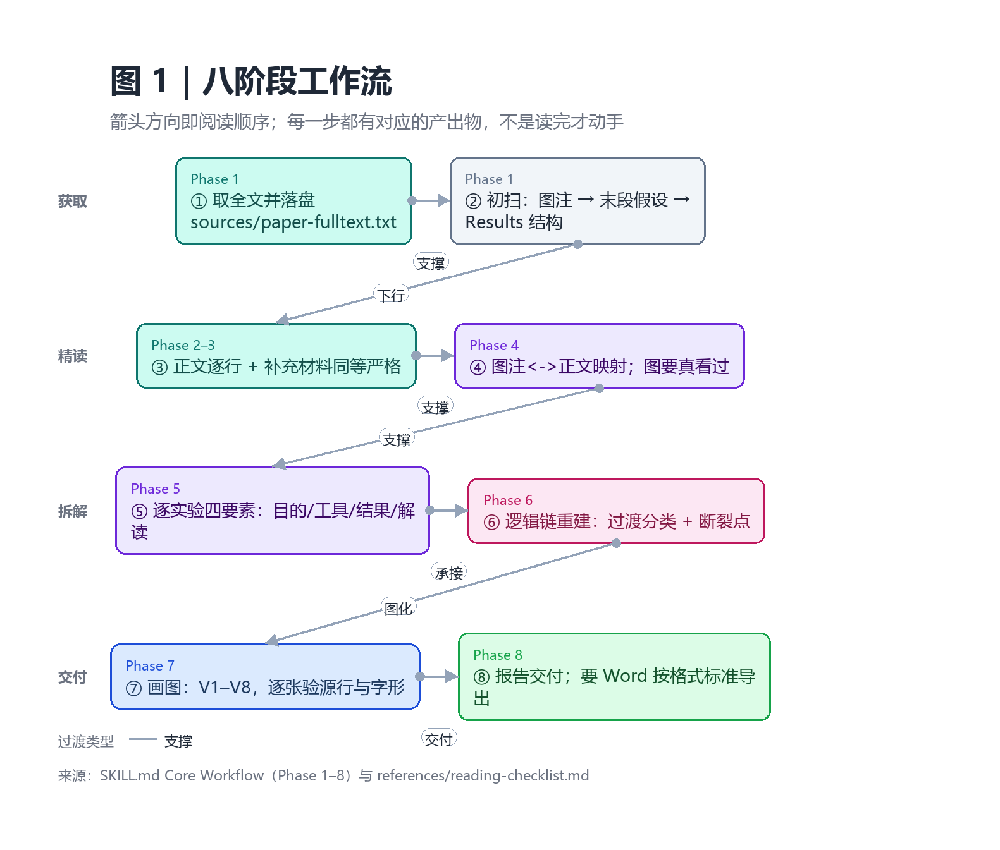
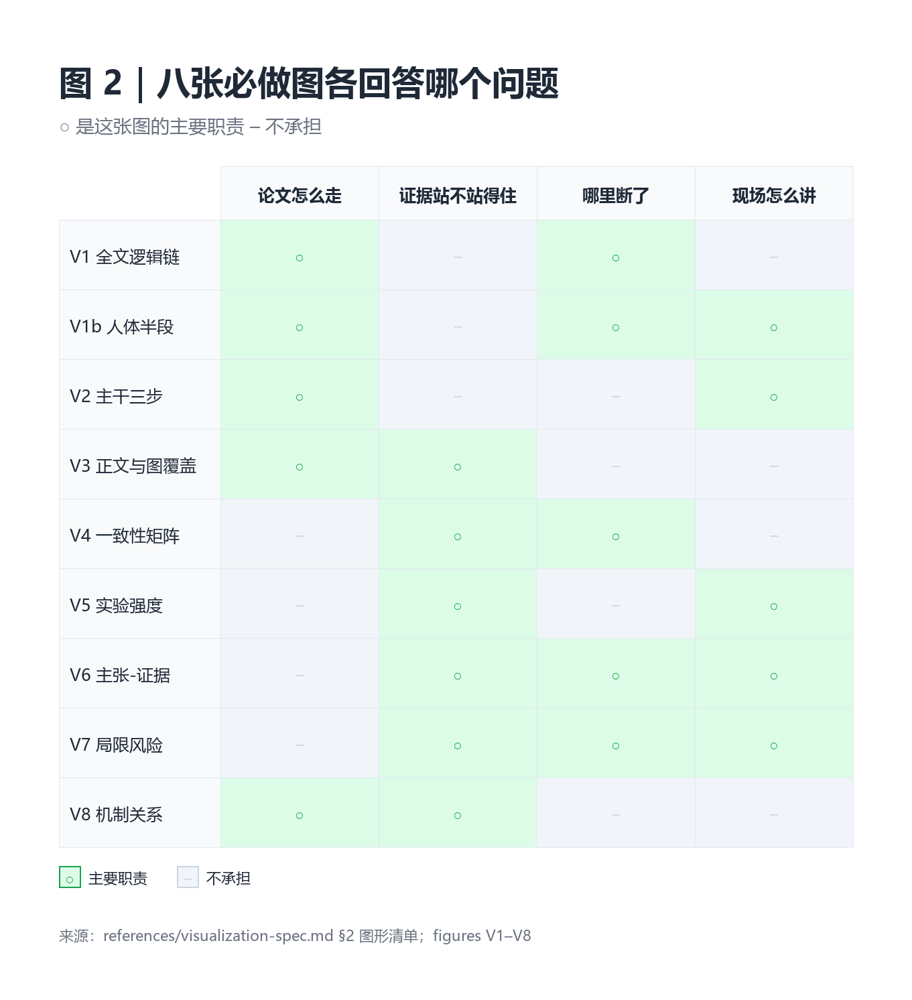

# dsh-plugin-deep-paper-reading

A **DeepSeek Harness plugin** that ships the *文献精读模式* (Deep Paper Reading) agent preset: install it and the preset picker gains a mode for figure-by-figure, experiment-by-experiment close reading of a **single** biomedical paper.

**Since v0.2.0 the report is diagram-first.** The paper's logic chain is drawn as a flowchart instead of described in prose, and the judgement sections (figure/text consistency, experiment strength, claim-evidence gap, limitation risk, term relations) each get a figure. A **Word conversion standard** ships with the skill, so the report exports to a compliant `.docx`.

- Keywords: `dsh-plugin` · `deepseek-harness` · `agent-preset` · paper reading · diagrams · DOCX
- License: MIT

---

## What changed in 0.2.0

| Change | Detail |
|---|---|
| **Logic chain as a diagram** | New Phase 7 "Visualization Assembly" with **8 required figures** (V1–V8) plus 4 conditional/optional ones. A prose or ASCII logic chain is no longer an acceptable deliverable. |
| **Judgement figures** | Beyond the logic chain: figure/text consistency matrix, experiment-strength matrix, claim-evidence ladder, limitation risk map, text↔figure map, term/mechanism map. |
| **Offline renderer** | `scripts/render-diagram.py` turns a spec JSON into a PNG (and Mermaid source) with Pillow only — no Node, no Chromium, no network. A spec without a `source` line is rejected. |
| **Word conversion standard** | `references/docx-conversion-standard.md`: page setup, style matrix, table column cap, table-title-above / figure-title-below, the `○ △ × –` glyph set, a 25-item acceptance list, and recorded render tiers. |
| **Stronger checks** | `check-composition.py` now verifies that every file SKILL.md tells the agent to open is actually packaged, and that V1–V8 are declared in both SKILL.md and the visualization spec. CI renders the sample figures. |
| **The skill is no longer byte-identical to upstream** | The skill body was edited for the above (it used to be a verbatim copy); provenance notes updated. |

## What it can do

Full introduction (Chinese, with four capability figures): [docs/skill-intro.md](docs/skill-intro.md).

The eight-phase workflow — arrow direction is reading order, and every phase has an artifact:



Which required figure answers which question — structure, evidence, gap, and stage delivery are separate jobs:



Also: [deliverables and the gates they must pass](docs/capabilities/cap-3-deliverables.png) · [what a real run looks like](docs/capabilities/cap-4-sample.png)

## What the mode does

1. Acquire and first-pass scan the paper; persist the full text to `sources/paper-fulltext.txt`
2. Read the main text line by line
3. Treat supplementary material with the same rigor; label anything unobtainable as **missing**
4. Build the **figure-legend ↔ main-text correspondence table** plus V3 (text↔figure map) and V4 (consistency matrix)
5. Decompose **every** experiment into purpose / design & tools / results / interpretation, plus V5 (strength overview)
6. Reconstruct the logic chain, classifying each transition as elimination, extension, mechanism, application, or validation — unclassifiable transitions become **dashed edges**
7. **Render V1–V8**, then check each PNG for existence, width, real Chinese glyphs, and the three-line caption
8. Assemble the report; export to Word following the bundled standard

Three hard constraints live in the persona:

- **Evidence boundary** — never invent figure panels, legends, numbers, p-values, sample sizes, catalog numbers, or a claim of full-text access.
- **Figures must actually be looked at** — if a judgement rests on a legend rather than the image, say so.
- **Figures must actually be drawn** — an ASCII sketch, a table drawing, or an empty placeholder is not a figure; if nothing renders, say "unrendered (reason)" and keep the Mermaid source.

## Figure inventory

| ID | Figure | Kind | Level |
|---|---|---|---|
| **V1** | Full-paper logic chain (layers + transition types + dashed breaks) | flow | required |
| **V2** | Trunk only (the three steps you must remember) | flow | required |
| **V3** | Text↔figure bipartite map | flow | required |
| **V4** | Legend/text consistency matrix | matrix | required |
| **V5** | Experiment evidence-strength overview | matrix | required |
| **V6** | Claim-evidence sufficiency ladder | matrix | required |
| **V7** | Limitation risk map (impact × severity) | scatter | required |
| **V8** | Term/mechanism relation map | flow | required |
| **V9** | Alternative-hypothesis decision tree | flow/tree | conditional |
| **V10** | Cohort / enrollment flow | flow | conditional |
| **V11** | Experimental timeline | timeline | optional |
| **V12** | Evaluation radar | — | default: do not draw |

Rendering ladder (record the tier in every caption): **A** `mmdc` → **B** `npx -y @mermaid-js/mermaid-cli` → **C** `python scripts/render-diagram.py spec.json --out fig.png --mermaid fig.mmd` (offline, Pillow only) → **D** unrendered, labelled.

```sh
python presets/deep-paper-reading/skills/deep-paper-reading/scripts/render-diagram.py \
  --selftest --tmp /tmp/diagram-check
```

See `references/visualization-spec.md` and `assets/diagram-specs.md`.

---

## Install

### 1. As a bundle (needs the `dsh` CLI)

```sh
dsh plugin --profile web add github:1283011852/dsh-plugin-deep-paper-reading
# DSH Desktop: pnpm dsh plugin --profile web add github:1283011852/dsh-plugin-deep-paper-reading
```

No `prepare` script and no npm dependencies, so pnpm's git-build permission prompt does not apply. Restart DSH, then pick `文献精读模式` in the preset picker. Remove with `dsh plugin --profile web remove dsh-plugin-deep-paper-reading`.

### 2. As a preset package (`.dshpreset`) — no CLI

Download `dsh-plugin-deep-paper-reading-<version>.dshpreset` from [Releases](../../releases) and import it in DSH Desktop. The desktop validates, previews, and atomically installs into the user preset root; an existing preset id is never overwritten. This path touches no profile configuration.

### 3. Skill only

```sh
cp -r presets/deep-paper-reading/skills/deep-paper-reading ~/.agents/skills/
```

Then `deep-paper-reading` is callable through the `skill` tool in any mode, without the mode persona. The skill directory carries `scripts/render-diagram.py`, so the rendering capability travels with it. (DSH does not scan `~/.claude/skills/`.)

---

## Usage

Start a session on **文献精读模式** and point it at a PDF or DOI. The report lands in `paper-reading/<short-slug>-精读报告.md`, extracted text and page renders under `sources/`, diagram PNGs plus their specs under `paper-reading/figures/` — unless the workspace already has an established layout.

The skill assumes a working PDF toolchain (`python` + PyMuPDF). If it is missing the agent says so rather than pretending it read the full text.

---

## Layout

```
├── package.json                    # dsh.bundle.patch → cordis.patch.yml
├── cordis.patch.yml                # registers this package's presets/ as a roster root
├── index.js                        # boot-time self-check row
├── presets/deep-paper-reading/
│   ├── agent.cordis.yml            # persona (incl. VISUALS) + bundled skill mount
│   ├── preset.yml
│   ├── SOURCE.md
│   └── skills/deep-paper-reading/
│       ├── SKILL.md                            # 8-phase workflow
│       ├── assets/report-template.md           # report template (figure slots + captions)
│       ├── assets/diagram-specs.md             # V1–V11 specs (JSON + Mermaid)
│       ├── references/reading-checklist.md
│       ├── references/visualization-spec.md    # diagram contract
│       ├── references/docx-conversion-standard.md
│       ├── references/biomedical-tools.md
│       └── scripts/render-diagram.py           # offline renderer (Pillow)
├── scripts/build-dshpreset.mjs     # dependency-free .dshpreset packer
├── scripts/check-composition.py    # composition + bundled-file + V1–V8 checks (CI)
└── .github/workflows/              # ci.yml (incl. renderer selftest), release.yml
```

---

## ⚠️ Known impact

This plugin's patch **replaces the whole `config` of the `agent-presets` row**, because DSH patches replace a targeted row's config value rather than deep-merging its keys. Every key that row requires is therefore restated in `cordis.patch.yml`, which means:

1. **The `roots` list belongs to this plugin.** If another bundle or your own `cordis.patch.yml` also configures `agent-presets`, the later layer wins outright and the earlier roots disappear. To keep both, merge the two `roots` arrays by hand in your profile patch instead of mounting both bundles.
2. **`default` is restated as `standard`.** Your `agent-presets.default` in `$DSH_HOME/settings.yaml` lives in the settings layer, outranks the config, and is unaffected.

Prefer the `.dshpreset` install if you would rather not take either consequence — it changes no profile configuration.

---

## Verification

What was actually checked before publishing, rather than assumed:

- **Preset mounts**: `agentPresets.standingKeyFor('deep-paper-reading')` → `mounted OK`, which composes the plugin subtree for real.
- **Bundled skill travels with the preset**: `customSkillDirs` uses `new URL('skills/', baseUrl)`, and the preset `Include` sets `baseUrl` to the composition's own directory, so the skill root resolves from the user root, this package's `presets/`, or an imported `.dshpreset`.
- **Bundle install and patch application**: in a throwaway profile, `dsh plugin add` this package, add the `dsh-web-app` layer, then `--dump-config` — the insert row lands and the `agent-presets` override restates all four keys.
- **The `!!js` expression evaluates**: `dsh --profile <test profile> --help` loads every row and evaluates its config — exit 0, with the plugin's self-check row printing `registered from …\presets\deep-paper-reading`.
- **`--dump-config` proves the patch applied, not that it evaluated** (it prints the `!!js` source), which is why the step above is the one that matters.
- **Package format**: the packer mirrors the DSH Desktop importer's constraints and CI re-reads the archive with `unzip`. v0.2.0 run: `12 files, 172.5 KiB → 71.2 KiB`, with the renderer, spec and template files all inside.
- **Static composition checks**: `python3 scripts/check-composition.py` (every push). Since 0.2.0 it also verifies that every backticked `references/ · assets/ · scripts/` path named in SKILL.md is really packaged, and that V1–V8 are declared in both SKILL.md and `visualization-spec.md`.
- **Renderer self-test**: `--selftest` renders all four kinds and asserts that a spec without `source` is rejected. Locally the four PNGs came out 1020×1640 / 1360×816 / 1760×1232 / 1984×876 px, all ≥1200 px, with real Chinese glyphs.

Not verified:

- That the preset appears in *your* picker — that requires one real install, the only step that must happen in a live environment.
- On a Linux box with **no CJK font**, the renderer falls back to box glyphs (with a stderr warning); switch to mermaid-cli there. CI installs `fonts-noto-cjk` to cover that path.
- The actual Word layout: this repo publishes the standard and template only; reflow in specific Word/WPS versions needs the visual acceptance pass in section 13 of the standard.

---

## License and provenance

MIT — see [LICENSE](LICENSE).

- The bundled skill is the author's own (frontmatter records MIT and `skill-author: user`). **Since 0.2.0 it is no longer a byte-identical upstream copy**: Phase 7, the V1–V8 contract, the visualization spec, the diagram templates, the offline renderer and the Word standard were added, and the report template and checklist were rewritten to match.
- The Cordis composition derives from a locally authored `scientific-evidence-en-mode` preset: its tool surface is kept as-is, with the persona row rewritten (VISUALS paragraph added, OUTPUT updated), the bundled skill directory added, and display metadata written.
- Mermaid conventions (`accTitle`/`accDescr`, `classDef` only, `snake_case` ids, node caps) follow the K-Dense `markdown-mermaid-writing` style guides.
- Orientation evidence that diagrams aid comprehension (not a validation of this design): *Infographics Improve Comprehension and Recall at the Orthopaedic Journal Club* (J Surg Educ, 2020) and *Let Your Ideas Flow: Using Flowcharts to Convey Methods and Implications of the Results* (J Microbiol Biol Educ, 2018, PMC5969414).
- See `presets/deep-paper-reading/SOURCE.md`.
