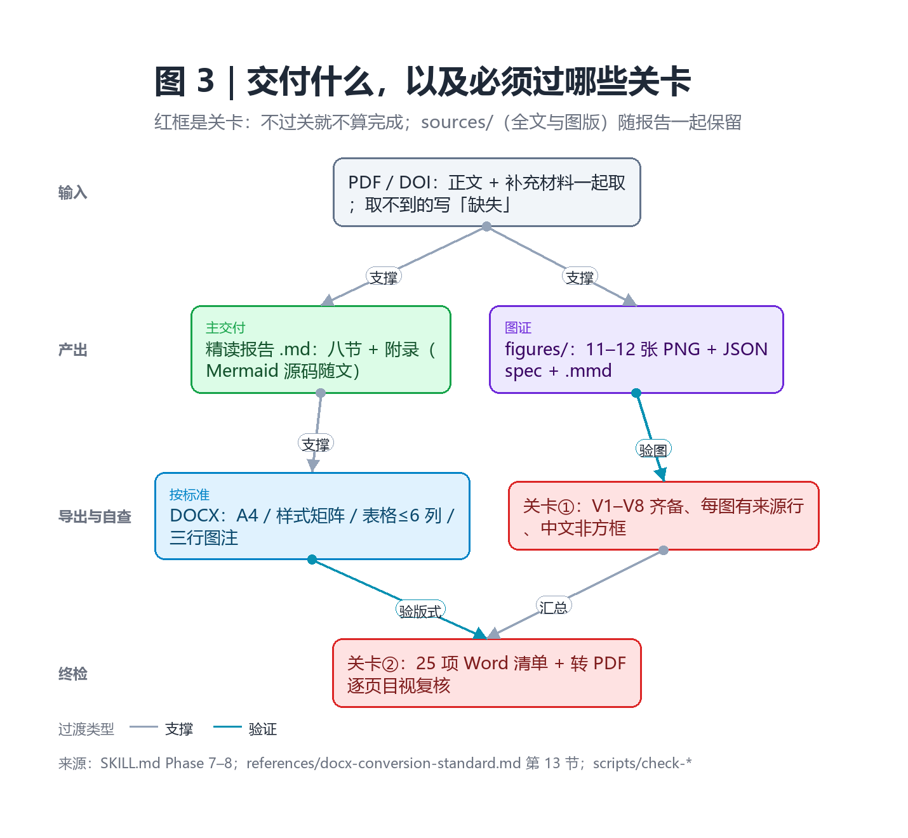
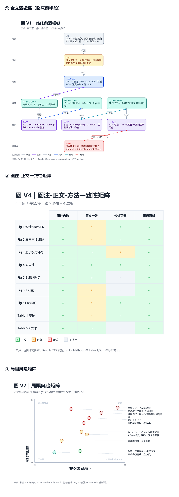

# 文献精读模式（deep-paper-reading）

**一句话**：把**一篇**生物医学论文拆到 journal club 的深度，并把「论文怎么走、证据站不站得住、哪里断了」**画成图**，而不是写成文字。

> 常规"精读"产出的是复述。复述会漏掉三样东西：图注与正文的对应关系、每个实验的设计细节、以及每一步过渡背后的逻辑理由。这个模式强制把三者显式化，并用 **8 张必做图 + 证据表**交付——图给结构，表给证据。

---

## 主要功能

| # | 功能 | 产出 |
|---|---|---|
| 1 | **全文获取与落盘**：正文、STAR Methods、补充图、补充表一起取；取不到的显式写「缺失（正文引用但未获取）」 | `sources/paper-fulltext.txt` + 图版渲染 |
| 2 | **图注 ↔ 正文映射**：逐图比对图注、正文与原始图像；判断若基于图注而非图像，必须写明 | 对应表 + 一致性矩阵 |
| 3 | **逐实验四要素拆解**：目的 / 设计与工具（含货号、n、统计学）/ 结果（含具体数值）/ 解读（含替代解释） | 每个实验一节 |
| 4 | **逻辑链重建**：每个过渡分类为排除 / 扩展 / 机制 / 应用 / 验证；无法归类的转折就是断裂点 | 逻辑链图 + 过渡表 |
| 5 | **图表化交付**：8 张必做图 + 条件图；内置离线渲染器（只依赖 Pillow，无需 Node / Chromium / 网络） | `figures/*.png + .json + .mmd` |
| 6 | **Word 导出**：按内置《Word 格式转换标准》导出，含 25 项验收清单与"未渲染不得冒充"规则 | `.docx`（+ PDF 复核） |

## 三条硬规则

- **图与数据并存**——图是索引，表是证据；删掉表就丢掉 n、p、货号与原文句子。
- **可溯源**——每张图都有一条「来源：Fig X / Results §Y / Table Z」；渲染器对缺 `source` 的 spec **直接报错**。
- **失败要标注**——渲染器缺失、字体缺字、补充材料没拿到，都写清楚；禁止用 ASCII 框图或空占位符冒充图。

---

## 能力一览（4 张图）

### 图 1　八阶段工作流

箭头方向即阅读顺序，每一步都有产出物——不是"读完再动手"。


### 图 2　八张必做图各回答哪个问题

结构、证据、缺口、现场讲解四类问题，分别由不同的图承担；`○` 是主要职责。


### 图 3　交付什么，以及必须过哪些关卡

红框是关卡：V1–V8 不齐、没有来源行、Word 版式没目视复核，就**不算完成**。



### 图 4　真实跑出来的样子（Cell 2026 · mRNA-TCE 治疗难治性 ITP）

同一份报告的三张图：逻辑链、图注-正文一致性矩阵、局限风险矩阵。完整报告见仓库外的 `paper-reading/mrna-cd19-tce-itp/`。



---

## 输出物

```
paper-reading/<短标题>/
├── <短标题>-精读报告.md      # 八节 + 三个附录，含全部 Mermaid 源码
├── <短标题>-精读报告.docx    # 可选：按 Word 格式标准导出
├── figures/                  # V1–V11：PNG + JSON spec + Mermaid
└── sources/                  # 全文文本 + 图版渲染（供复核）
```

## 边界（明确不做）

- **多篇文献综述** → `literature-review`
- **正式同行评审 / 评分** → `peer-review`
- **文献检索** → `paper-lookup`
- **编造**：不编图号、数字、p 值、样本量、货号、引文；只读到摘要就标「证据等级：摘要级」

## 安装（三选一）

```sh
# 1) 作为插件（有 dsh CLI）
dsh plugin --profile web add github:1283011852/dsh-plugin-deep-paper-reading

# 2) 作为预设包：从 Releases 下载 .dshpreset，在 DSH Desktop 里导入

# 3) 只要技能本体（任何模式下可 skill 调用）
cp -r presets/deep-paper-reading/skills/deep-paper-reading ~/.agents/skills/
```

当前版本 **v0.2.0**（图表化交付 + 离线渲染器 + Word 格式标准）。渲染器自检：

```sh
python scripts/render-diagram.py --selftest
```

> 本介绍页的 1–3 图均由该渲染器自身生成（档 C，离线），算是"用自己的工具介绍自己"。
